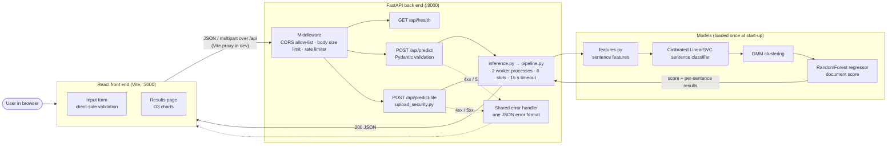

# COS30049 Group 2 – AI-Generated Content Detection

A web application that estimates how likely a piece of writing is to be AI-generated. A user pastes text or uploads a `.txt` file. The FastAPI back end runs our trained model pipeline and returns a document-level score plus per-sentence scores. The React front end shows these as interactive charts.

**Who it's for:** teachers and students who want a second opinion on whether a piece of writing *looks* machine-written. It is a learning project, not a disciplinary tool. See [Limitations and next steps](#limitations-and-next-steps).

---

## Contents
1. [Architecture](#architecture)
2. [Setup and run](#setup-and-run)
3. [Pinned dependency versions](#pinned-dependency-versions)
4. [API documentation](#api-documentation)
5. [Threat model](#threat-model)
6. [Security hygiene](#security-hygiene)
7. [Defences chosen](#defences-chosen)
8. [Innovation defence 1: Unsafe file upload](#innovation-defence-1-unsafe-file-upload)
9. [Innovation defence 2: Denial of service](#innovation-defence-2-denial-of-service)
10. [Advanced security: Detection evasion](#advanced-security-detection-evasion)
11. [Limitations and next steps](#limitations-and-next-steps)
12. [Generative AI statement](#generative-ai-statement)
13. [References](#references)

---

## Architecture



**Request flow (text prediction):**
1. The front end validates the text length and minimum word count, then sends `POST /api/predict` with `{"text": "..."}`.
2. Middleware checks the origin (CORS), the request body size and the client's request rate.
3. Pydantic validates the body against `PredictRequest`. Invalid input returns 422 in the shared error format.
4. `pipeline.py` splits the text into sentences and builds the same features used in training (`features.py`). The sentence classifier scores each sentence, the GMM assigns a cluster, and the regressor turns these into one document-level score.
5. The back end returns `PredictResponse` as JSON, and the front end renders the score, confidence and charts.

**Repository layout**

| Folder | Contents |
| --- | --- |
| `backend/` | FastAPI app. The trained models it loads are already included in `backend/models/`. |
| `frontend/` | React + Vite front end. |
| `model_training/` | EDA notebook, training and evaluation scripts, evasion experiments and their results. Only needed to retrain. |

---

## Setup and run

You need **Python 3.13** and **Node.js 20.19 or newer**. The trained models are already in `backend/models/`, so **to run the application you only need steps 1, 2 and 3**. Steps 4–6 are only needed to retrain the models.

### 1. Back-end environment

From the repository root (Windows PowerShell):

```powershell
python -m venv .venv
.venv\Scripts\activate
pip install -r requirements.txt
```

On macOS/Linux, activate with `source .venv/bin/activate` instead. `requirements.txt` pins every package version.

Conda works too:

```powershell
conda create -n ai-detect python=3.13 -y
conda activate ai-detect
pip install -r requirements.txt
```

### 2. Start the back end

```powershell
cd backend
uvicorn main:app --host 127.0.0.1 --port 8000
```

Open http://127.0.0.1:8000/docs to see the interactive API documentation. A quick check from a second terminal:

```powershell
curl.exe http://127.0.0.1:8000/api/health
```

It should return `{"status":"ok","model_loaded":true,...}`.

Optional environment variables (copy `backend/.env.example` to `backend/.env` to set them; every one has a safe default):

| Variable | Default | Purpose |
| --- | --- | --- |
| `ALLOWED_ORIGINS` | `http://localhost:3000,http://127.0.0.1:3000` | Comma-separated CORS allow-list |
| `MAX_CHARS` / `MIN_WORDS` | `10000` / `20` | Text limits (keep in sync with `frontend/src/config.js`) |
| `DOS_PROTECTION` | `on` | `off` runs the unprotected version, only for the "before" DoS measurement |
| `INFERENCE_WORKERS` / `INFERENCE_QUEUE` | `2` / `4` | Worker processes running the model / extra requests allowed to wait |
| `INFERENCE_TIMEOUT` | `15` | Seconds before a prediction returns 503 |
| `RATE_LIMIT_PER_MINUTE` | `30` | Prediction requests per client IP per minute (`0` = off) |

### 3. Start the front end

Open a **second** terminal and leave the back end running in the first. Check your Node version (tested on Node 24.21.0):

```powershell
node -v
```

Install the exact package versions from `package-lock.json` (first time only), then start the development server:

```powershell
cd frontend
npm ci
npm run dev
```

Open http://localhost:3000. Press `Ctrl + C` to stop the server. It must run on port 3000, because that is the origin allowed by CORS. If port 3000 is already in use, it stops with an error instead of switching ports.

**Connecting to the back end.** In development, every request to `/api` is forwarded to the FastAPI server at `http://127.0.0.1:8000`, so **start the back end first**. The header shows **"Model online"** when the back end is reachable and **"Service offline"** when it is not.

**Demo mode (front end only, no back end).** To work on the interface without the back end, create `frontend/.env.local` containing:

```
VITE_USE_MOCK=true
```

Then restart `npm run dev`. A **"Demo data"** badge appears in the header, and results come from a simple word-pattern heuristic in `src/api/mock.js`, **not** the trained model. Delete `.env.local` (or set the value to `false`) and restart to use the real model. File uploads always use the real back end, even in demo mode.

More detail on the front end (folder structure, API contract, error format) is in [`frontend/README.md`](frontend/README.md).

### 4. (Retraining only) Extra packages and data

```powershell
pip install matplotlib seaborn jupyter
```

The raw datasets are too large for GitHub (one is over the 100 MB limit), so they are not included. Download these three Kaggle datasets and put the CSVs in `model_training/data/`:

| Dataset | File to place in `model_training/data/` |
| --- | --- |
| [DAIGT V2 Train Dataset](https://www.kaggle.com/datasets/thedrcat/daigt-v2-train-dataset) | `train_v2_drcat_02.csv` |
| [AI Vs Human Text](https://www.kaggle.com/datasets/shanegerami/ai-vs-human-text) | `AI_Human.csv` |
| [AI vs Human Text Classification Dataset 2026](https://www.kaggle.com/datasets/alitaqishah/ai-vs-human-text-classification-dataset-2026) | `ai_vs_human_text_2026.csv` |

### 5. (Retraining only) Process the data

Run the notebook top to bottom. It writes the train, validation, test and `holdout_2026` splits to `model_training/data/splits/`.

```powershell
cd model_training
jupyter notebook eda.ipynb
```

### 6. (Retraining only) Train the models

Run these from inside `model_training/`, in order, because each step uses the outputs of the previous one. All scripts use fixed random seeds. The GMM and regressor scripts read from and write to `backend/models/` by default.

```powershell
# Sentence classifiers: logistic regression vs calibrated LinearSVC
python classifier.py --model logreg --out models/clf_logreg.joblib
python classifier.py --model svc --out models/clf_svc.joblib

# The LinearSVC won, so copy it to the name the pipeline loads
copy models\clf_svc.joblib ..\backend\models\classifier.joblib

# Innovation comparison: LightGBM on the same sentences
# (early stopping uses 5,000 documents held back from the training split)
python lgbm_classifier.py                 # -> models/clf_lgbm.joblib

# GMM clustering on AI training sentences only (k = 6, full covariance)
# Also saves the BIC curve and cluster profile tables
python gmm.py --k 6                       # -> ../backend/models/gmm.joblib

# Document-level regressor, fitted on the VALIDATION split
# (documents the classifier and GMM never saw), evaluated on test + holdout_2026
python regressor.py                       # -> ../backend/models/regressor.joblib
```

Restart the back end afterwards so it loads the new models.

---

## Pinned dependency versions

All back-end versions are pinned in `requirements.txt`; front-end versions are pinned exactly in `package.json` and `package-lock.json` (`.npmrc` sets `save-exact=true`).

**Back end / ML (Python 3.13)**

| Package | Version |
| --- | --- |
| pandas | 3.0.6 |
| numpy | 2.5.3 |
| scikit-learn | 1.9.1 |
| lightgbm | 4.7.0 |
| joblib | 1.6.0 |
| fastapi | 0.143.0 |
| starlette | 1.8.0 |
| pydantic | 2.14.1 |
| uvicorn | 0.54.0 |
| python-multipart | 0.0.32 |
| python-dotenv | 1.2.4 |
| httpx (DoS demo script) | 0.28.1 |

**Front end (Node 20.19+, tested on Node 24.21.0)**

| Package | Version |
| --- | --- |
| react / react-dom | 19.3.0 |
| react-router-dom | 7.18.4 |
| d3 | 7.9.0 |
| lucide-react | 1.48.0 |
| vite | 8.3.6 |
| @vitejs/plugin-react | 6.1.1 |

---

## API documentation

FastAPI generates interactive documentation at http://127.0.0.1:8000/docs. Every endpoint has a description and an example request and response, including the error responses.

| Method | Path | Purpose | Front-end caller (`frontend/src/api/detector.js`) |
| --- | --- | --- | --- |
| GET | `/api/health` | Reports whether the server is up and the models are loaded. Drives the "Model online" badge. | `getHealth()` |
| POST | `/api/predict` | Scores pasted text sent as JSON `{ "text": "..." }`. | `predict(text)` |
| POST | `/api/predict-file` | Scores an uploaded `.txt` file (multipart form, field `file`). | `predictFile(file)` |

Example response from `POST /api/predict`:

```json
{
  "label": "ai",
  "confidence": 0.87,
  "ai_score": 0.87,
  "score_range": { "low": 0.72, "high": 0.97 },
  "sentences": [
    { "text": "Climate change is one of the most pressing issues of our time.", "p_ai": 0.91 },
    { "text": "It affects ecosystems, economies and communities around the world.", "p_ai": 0.83 }
  ],
  "word_count": 23,
  "model_version": "svc-gmm-rfr-1.0"
}
```

**Error format.** Every error uses one JSON shape, with no stack traces or internal details. `details` lists field-level problems for validation errors and is empty otherwise:

```json
{
  "error": {
    "code": "text_too_long",
    "message": "Text must be at most 10,000 characters.",
    "details": [{ "field": "text", "message": "Text must be at most 10,000 characters." }]
  }
}
```

| Status | When | Example `code` |
| --- | --- | --- |
| 404 / 405 | Unknown endpoint or wrong method | `http_404`, `http_405` |
| 413 | Text over 10,000 characters, file over 32,000 bytes, or body over 41,024 bytes | `text_too_long`, `file_too_large`, `payload_too_large` |
| 415 | Not a `.txt` file, unsafe file name, not UTF-8, or binary content | `unsupported_file_type`, `invalid_encoding`, `invalid_file_content` |
| 422 | Invalid JSON, wrong or extra fields, too few words, empty file, nothing scorable | `validation_error`, `text_too_short`, `empty_file`, `no_scorable_sentences` |
| 429 | More than 30 predictions per minute from one IP (with `Retry-After`) | `rate_limited` |
| 500 | Any unexpected error (details logged on the server only) | `internal_error` |
| 503 | All inference slots busy, or prediction took over 15 s (with `Retry-After`) | `server_busy`, `processing_timeout` |

### How the front end talks to the API
All calls go through `frontend/src/api/`:

- **`detector.js`** holds the three functions the UI uses. Components import only from here. When `VITE_USE_MOCK=true`, health checks and text predictions come from `mock.js` instead, and nothing else in the UI changes. File uploads always use the real back end.
- **`client.js`** is one wrapper around `fetch()`. It sends JSON or multipart form data, applies a timeout (20 s by default, 5 s for health checks), supports cancelling a request, and turns every failure into an `ApiError` with a readable message. This covers our shared error format, FastAPI's default `{ detail }` format, timeouts, and the back end being offline. `fieldErrors` lets a form show the message beside the right input.
- **`mock.js`** returns demo responses in the same shape as the real API, including errors. Typing `#error` or `#busy` in the text shows the 500 and 503 error states without a back end.

---

## Threat model

### 1. Who would want to attack this application?
- **Students submitting AI-written work** who want the detector to label it human. This is the main motivated attacker, and the reason the detector exists.
- **Anyone who can reach the API.** The API has no login, so any script or bot can call `/api/predict` and `/api/predict-file` directly, without going through the front end.

### 2. What are they trying to achieve?
- **Evade detection:** change AI text just enough that the model scores it as human (see [Advanced security](#advanced-security-detection-evasion)).
- **Make the service unavailable:** for example, flooding the prediction endpoint so that real users (teachers checking work near a deadline) get timeouts.
- **Abuse the upload path:** send oversized files, path-traversal file names or binary content to exhaust memory, crash the server or reach the file system.

### 3. What can they actually do to it?
- **Bypass all front-end checks** by calling the API with `curl` or a script. So every limit is also enforced on the back end.
- **Send many requests quickly.** Model inference is CPU-bound, so a single client can tie up the server. This exposes **denial of service**.
- **Upload any bytes with any file name and MIME type.** This exposes **unsafe file upload**.
- **Rewrite their own text** (change case, strip punctuation, paraphrase) to hide the features the model relies on. This is the detection-evasion attack.
- **Privacy risk to users:** essays often contain names, student IDs or contact details. The back end does not store submitted text or files after the response is sent. Server logs record only the method and path of unexpected errors, never the submitted text, and validation errors never echo the input back. The front end keeps results only in `sessionStorage`, which is cleared when the tab closes.

### Section 2.7 risks: which apply to this design

| Risk | Applies? | Why |
| --- | --- | --- |
| Unsafe file upload | **Yes – chosen** | We accept user files at `/api/predict-file`. |
| Denial of service | **Yes – chosen** | Public, unauthenticated, CPU-heavy inference endpoint. |
| Missing rate limiting | Yes – covered inside the DoS defence | Anyone can probe the detector repeatedly. Our per-IP limit (`limits.py`) is one layer of the DoS defence, not a separate marked defence. |
| Unsafe model loading | Yes – not chosen | We load `.joblib` files, which can run code when loaded. The risk is low here because the models ship in the repository and are loaded from a fixed path, with no download script; it would matter if models came from an outside source. |
| Misconfiguration and vulnerable dependencies | Yes – not chosen | Applies to every app. `npm audit` reports 0 vulnerabilities; CORS and request limits are set explicitly. |
| Command injection | No | The back end never runs a system command. |
| SQL injection | No | There is no database; nothing is stored. |
| Server-side request forgery | No | The back end never makes an outbound request based on user input. |
| Broken access control | No | There are no user accounts or per-user records. |

---

## Security hygiene

- **Safe text rendering:** submitted sentences are rendered as React text children, never interpreted as HTML (no `dangerouslySetInnerHTML`).
- **Back-end input limits:** text is limited to 10,000 characters; uploaded files to 32,000 bytes; the total request body to 41,024 bytes. The back end enforces these limits independently of the front end.
- **Restricted CORS:** the default allowed origins are exactly `http://localhost:3000` and `http://127.0.0.1:3000`, configurable through `ALLOWED_ORIGINS`. CORS controls browser access only; it is not authentication.
- **Secret handling:** the app has no secrets. All settings come from environment variables (`backend/settings.py`), local `.env` files and private-key file patterns are in `.gitignore`, and only `.env.example` files are committed. `VITE_*` variables are public build settings and never contain secrets. Gitleaks scans of the working tree and the full Git history found no secrets.

CORS preflight tests returned HTTP 200 for `http://localhost:3000` and HTTP 400 ("Disallowed CORS origin") for `https://example.com`.

---

## Defences chosen

| Section | Defence | Where in the code |
| --- | --- | --- |
| 2.7 Innovation defence 1 | **Unsafe file upload** | `backend/upload_security.py`, `BodySizeLimitMiddleware` in `backend/limits.py` |
| 2.7 Innovation defence 2 | **Denial of service** | `backend/inference.py` (`InferenceGate`), `backend/limits.py` (`RateLimiter`, `BodySizeLimitMiddleware`), settings in `backend/settings.py`; demo script `backend/dos_demo.py` |
| 2.8 Advanced security | **Detection evasion** (case and punctuation stripping) with balanced adversarial retraining | `model_training/evasion_lib.py`, `evasion_retrain.py`, `evasion_run.py`, `evasion_eval.py` |

---

## Innovation defence 1: Unsafe file upload

### Threat and defence
An attacker can bypass browser validation and send oversized files, crafted file names, or binary content disguised as plain text directly to `POST /api/predict-file`. FastAPI does none of these checks by default: `UploadFile` accepts any file name, any declared MIME type and any size.

`backend/upload_security.py` validates every upload before model inference:
- Accepts only file names ending in `.txt` (case-insensitive), so `evil.exe` and `evil.txt.exe` are rejected.
- Rejects file names containing `/`, `\` or ASCII control characters below 32.
- Reads at most 32,001 bytes and rejects files larger than 32,000 bytes, so a huge file is never fully read into memory. `BodySizeLimitMiddleware` also rejects any request body over 41,024 bytes before it is parsed.
- Decodes the actual bytes as UTF-8 (BOM allowed). It does not trust the declared MIME type, so a PNG, PDF or UTF-16 file renamed to `.txt` is rejected.
- Rejects unsupported control characters, empty files and whitespace-only content.
- Applies the same character limit and minimum word count as `/api/predict`.
- Closes the upload in a `finally` block. The application never saves uploads to disk under a user-supplied name, and never executes them (multipart parsing may use temporary storage). This is why a crafted file name cannot write outside a folder even if it got past the name check: the name is only validated, never used as a path.

### Direct API test results
Tested with `curl.exe` against our own application at `http://127.0.0.1:8000`, bypassing the front end.

| Test | Submitted input | Observed response |
| --- | --- | --- |
| Oversized file | 32,001 ASCII bytes in `large.txt` | HTTP 413 `file_too_large` |
| Crafted file name | Plain text with `filename=../test.txt` | HTTP 415 `unsupported_file_type` |
| Crafted file name (Windows) | Plain text with `filename=..\..\x.txt` | HTTP 415 `unsupported_file_type` |
| Wrong extension | Plain text with `filename=evil.txt.exe` | HTTP 415 `unsupported_file_type` |
| Disguised binary | Bytes 0, 1, 2, 3 in `fake.txt`, declared `text/plain` | HTTP 415 `invalid_file_content` |
| Disguised image / PDF | PNG or PDF bytes renamed to `.txt` | HTTP 415 `invalid_encoding` |

All of these requests were rejected before model inference.

```powershell
curl.exe -X POST http://127.0.0.1:8000/api/predict-file -F "file=@large.txt"
curl.exe -X POST http://127.0.0.1:8000/api/predict-file -F "file=@essay.txt;filename=../test.txt"
curl.exe -X POST http://127.0.0.1:8000/api/predict-file -F "file=@fake.txt;type=text/plain"
```

### Trade-offs and limitations
- Only UTF-8 plain text is supported. PDF, Word and other encodings must be converted first.
- The content check is not an antivirus scan. HTML-like text that is valid plain text is accepted, but it is rendered as text, not HTML.
- A URL-encoded name such as `..%2f..%2fx.txt` passes the name check. It is harmless because file names are never used as paths, but the check could be tightened to reject `..` and `%`.
- Each upload costs one bounded read and a content scan before inference. In return, file formats and sizes are restricted.

---

## Innovation defence 2: Denial of service

### Threat
`/api/predict` and `/api/predict-file` need no login, and every request runs the full model pipeline on the CPU. In a naive FastAPI app, the model is called directly inside the `async` endpoint. That blocks FastAPI's single event loop for the whole prediction, so requests can only be handled one at a time. An attacker who sends many large but valid texts at once builds up a backlog with no limit, and every real user waits behind it.

Setting `DOS_PROTECTION=off` runs exactly this unprotected version. We use it only for the "before" measurement.

### Defence
Every prediction goes through `InferenceGate` in `backend/inference.py`:
- **The model runs off the event loop.** Predictions run in a `ProcessPoolExecutor` with 2 worker processes. Each worker loads the models once at start-up, so the server process stays free to answer other requests while the workers do the CPU work. Processes are used instead of threads because the model work is CPU-bound, and Python threads would compete for the same interpreter lock.
- **Load shedding with a fixed number of slots.** Capacity is 2 workers + 4 queued = **6** predictions in flight. When all 6 are taken, a new request is rejected immediately with **HTTP 503** `server_busy` and `Retry-After: 5`, instead of joining a queue that never ends.
- **Timeout.** A prediction that takes longer than **15 s** returns **HTTP 503** `processing_timeout`. The slot is freed only when the worker actually finishes, so a timed-out request can't let new work in while the CPU is still busy with the old one.
- **Per-IP rate limit** (`RateLimiter` in `backend/limits.py`). This is a sliding one-minute window per client IP on both prediction endpoints. The 31st request within a minute gets **HTTP 429** `rate_limited`, with a `Retry-After` header saying when to try again.
- **Body size limit.** `BodySizeLimitMiddleware` (also in `limits.py`) rejects request bodies over 41,024 bytes with 413 before they are parsed. It counts bytes as they arrive, so leaving out `Content-Length` (a chunked upload) doesn't get around it.

Every rejection uses the shared error format, and the front end shows it in the result panel with **Try again**.

### Test results
Measured with `backend/dos_demo.py` against our own server at `http://127.0.0.1:8000`. Both versions were run with `RATE_LIMIT_PER_MINUTE=0`, so the rate limiter didn't answer the flood with 429s before the inference gate was reached. The script runs two tests:
- **Expensive request:** one maximum-size (10,000-character) prediction, while a "normal user" keeps calling `/api/health` and a small `/api/predict`.
- **Flood:** many simultaneous 5,000-character predictions, with a `/api/health` call 0.3 s in.

```powershell
cd backend
# "before": unprotected server
$env:DOS_PROTECTION="off"; $env:RATE_LIMIT_PER_MINUTE="0"; uvicorn main:app --port 8000
python dos_demo.py --label before          # in a second terminal

# "after": restart the server with protection on
$env:DOS_PROTECTION="on"; $env:RATE_LIMIT_PER_MINUTE="0"; uvicorn main:app --port 8000
python dos_demo.py --label after
```

Results are appended to `backend/results/dos_results.csv`. That folder is gitignored, so the numbers are copied here.

**First comparison (flood of 50):**

| Measure | Unprotected | Protected |
| --- | --- | --- |
| `/api/health` while one max-size prediction runs | 151 ms | **14 ms** |
| Small `/api/predict` while one max-size prediction runs | 149 ms | **81 ms** |
| Predictions completed / rejected with 503 | 50 / 0 | **21 / 29** |
| Time until every request was answered | 6.4 s | **0.72 s** |
| Slowest completed prediction | 6,304 ms | **651 ms** |
| Median time to receive a 503 | – | **295 ms** |
| `/api/health` for a normal user during the flood | 5,404 ms | **270 ms** |

**Repeated unprotected runs at larger flood sizes:**

| Flood size | Time until every request was answered | Slowest completed prediction | `/api/health` during the flood |
| --- | --- | --- | --- |
| 50 | 1.99 s | 1,919 ms | 232 ms |
| 50 | 2.82 s | 2,431 ms | 236 ms |
| 150 | 7.52 s | 6,474 ms | 81 ms |
| 150 | 17.78 s | 17,076 ms | 325 ms |
| 200 | 27.29 s | 26,074 ms | 556 ms |

**What this shows.** Without protection, every request in the flood is accepted and queued, so the backlog grows with the size of the attack: the last prediction took about 2 s for a flood of 50, up to 17 s for 150 and 26 s for 200. A real user's prediction submitted during the flood would wait behind all of it, and past 20 s the front end gives up with a timeout. With protection, the gate accepts only what the workers can handle, answers the rest with a 503 in about 0.3 s, and the slowest accepted prediction stayed under 1 s.

The 5.4 s health-check delay in the first run did **not** repeat: in the later unprotected runs the health check took 81–556 ms, because the event loop can fit the quick health request in between predictions. So the clear and repeatable harm is the unbounded backlog for predictions, not the health check. One further run, logged as an unprotected run, is left out of this table because 66 of its requests received a 503, which only happens with the protection on.

**Rate limit check.** With `RATE_LIMIT_PER_MINUTE=30`, sending 31 small predictions in a row gives thirty 200s and then a 429 with `Retry-After`:

```powershell
$body = '{"text":"The committee reviewed the proposal carefully and agreed to revisit it next month. Several members raised concerns about the budget and the timeline for delivery."}'
1..31 | % { try { (Invoke-WebRequest http://127.0.0.1:8000/api/predict -Method POST -ContentType 'application/json' -Body $body).StatusCode } catch { $_.Exception.Response.StatusCode.value__ } }
```

### Trade-offs and limitations
- **Real users can be turned away.** When all 6 slots are full, legitimate requests get 503 too and must retry. The service stays up, but it serves fewer people at once. The numbers suit a 2-core laptop and can be changed with environment variables.
- **More memory.** Each worker process holds its own copy of the models, so memory use is about 2× the model size.
- **A timed-out prediction still uses its worker** until it finishes, because a running prediction can't be safely killed mid-way. The client still gets its 503 on time.
- **The rate limit is per IP and kept in memory.** Users behind one shared IP (a school network) share one limit. The counts reset when the server restarts and are not shared across several server instances. Many IPs together (a distributed attack) get past the rate limit. The gate still caps CPU use, so the server stays up, but real users would see more 503s.
- **Local testing caveat:** the attack script and a "normal user" on the same laptop share the IP `127.0.0.1`, so the rate limit would block both. That's why the flood was measured with the rate limit off and the rate limit was checked separately.
- **Measurement limits.** All runs were on one laptop, and run-to-run variation is large (two unprotected floods of 150 took 7.5 s and 17.8 s). The direction of the result was the same in every run.

---

## Advanced security: Detection evasion

**Attack.** Pasting an essay in lower case with the punctuation removed hides the case and punctuation cues the detector relies on. We tested this on our own detector, locally (fixed sample, seed 5; test n = 10,000; threshold 0.5).

**Metric.** Evasion success rate (ESR) is the share of AI essays caught before the attack that are missed after it. We report the attacked false-positive rate (FPR) beside it, because a model that labels everything "AI" is not defended.

| Detector | Clean: detection / FPR | Attacked: detection / FPR | ESR |
| --- | --- | --- | --- |
| Original | 0.909 / 0.046 | 0.018 / 0.000 | **0.981** |
| AI-only retrain | 0.910 / 0.045 | 1.000 / 1.000 | 0.000 |
| Balanced retrain | 0.909 / 0.046 | 0.934 / 0.217 | **0.040** |

**Defences.**
- *Normalisation* (lower-case, strip invisible characters; measured on holdout_2026) failed, because the punctuation was already deleted.
- *AI-only retraining* removed evasion but flagged every stripped human essay as AI.
- *Balanced retraining* (stripped copies of both human and AI essays) cut ESR from 0.98 to 0.04 with no clean-accuracy cost on test. It is stable across 3 training seeds (ESR 0.037 to 0.045).

**What still breaks it.** Stripping punctuation but keeping capitals gives ESR 0.76, so this is a partial defence. Stripped human essays are also flagged as AI 22% of the time (0% originally).

**Costs.** Training data grows by about 45% (about 40 s per retrain). Inference latency is unchanged (about 1.3 ms per document).

**Limitations.** The detector does not generalise to holdout_2026 (clean FPR 0.95), and only one attack family was tested.

**Reproduce.** Run from inside `model_training/` (needs the data from setup steps 4–5):

```powershell
cd model_training

# 1. AI-only retrained detector (evaluation loads it from models_adv/)
python evasion_retrain.py --mode ai_only

# 2. Baseline + attack + normalisation defence, one run per dataset
python evasion_run.py --dataset test
python evasion_run.py --dataset holdout_2026

# 3. Full evaluation: trains the 3 balanced seeds into models_adv_balanced/seed1..3 if missing,
#    compares original / AI-only / balanced, runs the keep-capitals attack and records timing.
#    All tables are written to results/evasion/.
python evasion_eval.py
```

---

## Limitations and next steps

### Limitations
- **False positives on newer and informal writing.** On the `holdout_2026` dataset, 95% of human texts are wrongly flagged as AI. Casual, first-person writing (such as the "Personal note" sample in the app) can also be scored as AI. Results must never be used to judge real students.
- The model was trained mostly on essay-style English. Other genres and languages are untested.
- Only UTF-8 plain-text uploads are supported.
- Only one evasion attack family (case and punctuation stripping) was measured, and the defence is partial (keeping capitals still evades it).
- There is no authentication, so rate limiting is per client address only, and a distributed attack from many IPs gets past it.
- DoS measurements come from a single laptop, with large run-to-run variation.

### Next steps
- Retrain with more recent and more varied human writing (2026 data, informal and non-essay text) to bring down false positives.
- Test more evasion attacks, such as paraphrasing, look-alike Unicode characters and inserted human-style sentences, and combine retraining with input normalisation.
- Add a "before" switch for the upload checks so the unprotected behaviour can be measured the same way as the DoS defence.
- Repeat the DoS measurements several times per configuration and report medians and ranges.
- Verify model files with a SHA-256 hash at start-up before loading them (unsafe model loading).
- Add security headers and run OWASP ZAP and `pip-audit` (misconfiguration and vulnerable dependencies).
- If user accounts were added, keep a per-user history of checks with proper access control.

---

## Generative AI statement

We used generative AI tools during this project as an aid, not as a replacement for our own work:

- **Claude (Anthropic)** was used to review the finished application against the assignment specification and marking rubric, to identify gaps, and to help restructure and edit this README.
- [Add any other tools your group used, e.g. ChatGPT or GitHub Copilot, and what each was used for.]

All design decisions, model training, experiments and measurements were carried out by the group. Every piece of AI-suggested code or text was reviewed, tested against our own application and edited by a group member before it was included, and the group takes responsibility for all submitted work.

---

## References

alitaqishah (2026) *AI vs Human Text Classification Dataset 2026* [dataset]. Kaggle. Available at: https://www.kaggle.com/datasets/alitaqishah/ai-vs-human-text-classification-dataset-2026 (Accessed: 8 November 2026).

Anthropic (2026) *Claude* [large language model]. Available at: https://claude.ai (Accessed: 10 November 2026).

Bostock, M., Ogievetsky, V. and Heer, J. (2011) 'D³: Data-driven documents', *IEEE Transactions on Visualization and Computer Graphics*, 17(12), pp. 2301–2309. doi:10.1109/TVCG.2011.185.

Chen, R., Xiong, S., He, J. and Ross, G.J. (2026) 'Stylometric detection of AI-generated texts: evidence from human and machine-written essays', *Digital Scholarship in the Humanities*, fqag064. doi:10.1093/llc/fqag064.

Joseph, E., Bennet, M. and Kingsley, T. (2025) *Feature-based detection of AI-generated text: an analysis of stylometric and perplexity markers in contemporary large language models*. Preprint. Available at: https://www.researchgate.net/publication/398588043 (Accessed: 8 November 2026).

Ke, G., Meng, Q., Finley, T., Wang, T., Chen, W., Ma, W., Ye, Q. and Liu, T.-Y. (2017) 'LightGBM: a highly efficient gradient boosting decision tree', *Advances in Neural Information Processing Systems*, 30, pp. 3146–3154.

Kumarage, T., Garland, J., Bhattacharjee, A., Trapeznikov, K., Ruston, S. and Liu, H. (2023) 'Stylometric detection of AI-generated text in Twitter timelines', *arXiv preprint* arXiv:2303.03697. doi:10.48550/arXiv.2303.03697.

OWASP Foundation (2021) *OWASP Top 10:2021*. Available at: https://owasp.org/Top10/ (Accessed: 10 November 2026).

Pedregosa, F. et al. (2011) 'Scikit-learn: machine learning in Python', *Journal of Machine Learning Research*, 12, pp. 2825–2830.

Ramírez, S. (2018) *FastAPI*. Available at: https://fastapi.tiangolo.com (Accessed: 8 November 2026).

shanegerami (2024) *AI Vs Human Text* [dataset]. Kaggle. Available at: https://www.kaggle.com/datasets/shanegerami/ai-vs-human-text (Accessed: 8 November 2026).

thedrcat (2023) *DAIGT V2 Train Dataset* [dataset]. Kaggle. Available at: https://www.kaggle.com/datasets/thedrcat/daigt-v2-train-dataset (Accessed: 8 November 2026).
